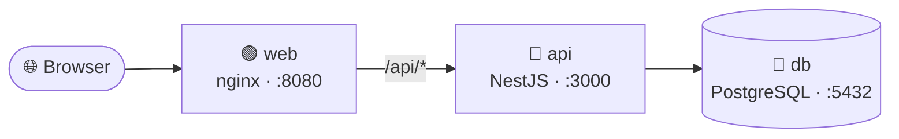
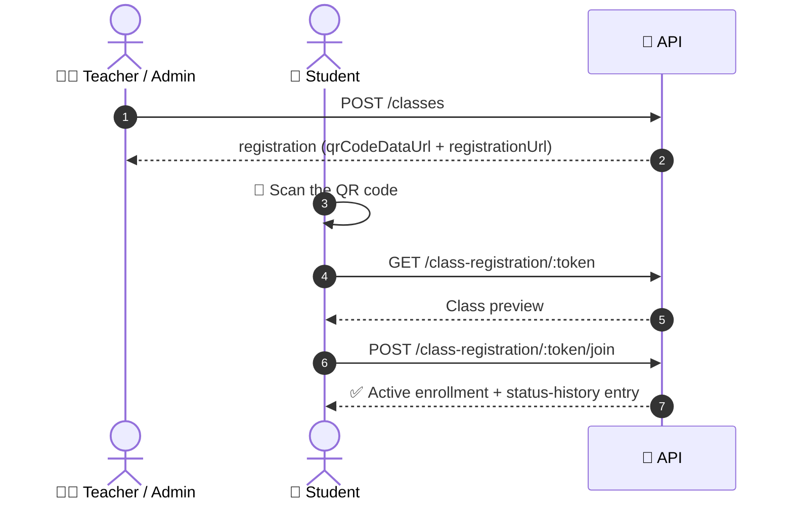

<div align="center">


<br>

🐳 **Docker Compose** &nbsp;•&nbsp; 🔴 **NestJS** &nbsp;•&nbsp; 🟢 **Vue.js** &nbsp;•&nbsp; 🐘 **PostgreSQL** &nbsp;•&nbsp; 🌐 **Nginx** &nbsp;•&nbsp; 🔐 **JWT**

**A REST API for running a whole school, deployed with a single command** 🚀

[🏗️ Architecture](#️-architecture) •
[⚡ Docker Quick Start](#-quick-start-with-docker) •
[💻 Local Dev](#-local-development) •
[🔐 Auth](#-authentication-and-roles) •
[🧩 Modules](#-modules) •
[📱 QR](#-class-registration-by-qr) •
[🌍 Deploy](#-deploying-to-a-server) •
[💾 Backups](#-backups)

</div>

---

## ✨ Overview

Manage **users, teachers, students, classes, courses, enrollments, attendance, lessons, assignments, submissions, exams, grading, groups, certificates, announcements, notifications, school rules and audit logs**.

Built with [NestJS](https://nestjs.com), TypeORM and PostgreSQL. All API routes are versioned under `/api/v1`.

---

## 🏗️ Architecture

The project ships with a multi-container Docker Compose stack:



<details>
<summary>📝 Plain-text version</summary>

```
Browser
  │
  ▼
web (nginx, port 8080) ──/api/*──▶ api (NestJS, port 3000) ──▶ db (PostgreSQL, port 5432)
```

</details>

### 📦 What's inside

| 📁 File | 🎯 Role |
| --- | --- |
| `school-management-api/Dockerfile` | 🔴 Builds the NestJS API |
| `school-management-web/Dockerfile` | 🟢 Builds the Vue app and serves it with nginx |
| `school-management-web/nginx.conf` | 🔀 Serves the SPA and proxies `/api` to the API |
| `docker-compose.yml` | 🧩 Runs PostgreSQL, the API and the web app together |

> [!NOTE]
> 🔒 Only the web port is published. The API and database stay on the internal Docker network; the browser reaches the API through `http://<host>:8080/api`.

---

# 🐳 Part 1 · Docker Deployment

## ⚡ Quick Start with Docker

From this directory (`School-Project`):

```bash
cp .env.example .env
# ✏️ Edit .env and change POSTGRES_PASSWORD and JWT_SECRET at minimum
docker compose up -d --build
```

> [!WARNING]
> 🔑 Always change `POSTGRES_PASSWORD` and `JWT_SECRET` before starting the stack.

### 🌐 Open

| Service | Link |
| --- | --- |
| 🖥️ Web app | <http://localhost:8080> |
| 🔌 API through the web proxy | <http://localhost:8080/api/v1> |

> [!TIP]
> ⏳ The first boot can take a few minutes because the API and web images are built.
> `DB_SYNCHRONIZE=true` (the default in `.env.example`) creates the database tables automatically from the TypeORM entities.

### 🩺 Check the stack

```bash
docker compose ps
docker compose logs -f api
docker compose logs -f web
```

✅ All three services should report `healthy`.

---

## 🔧 Docker Configuration

All settings live in `.env` at the root of this directory:

| 🏷️ Variable | 📖 Purpose | 🎚️ Default |
| --- | --- | --- |
| `APP_URL` | 🌍 Public URL of the web app, used by the API for CORS and QR links | `http://localhost:8080` |
| `WEB_PORT` | 🚪 Host port for nginx | `8080` |
| `POSTGRES_USER` | 👤 Database user | `postgres` |
| `POSTGRES_PASSWORD` | 🔑 Database password | generated in your `.env` |
| `POSTGRES_DB` | 🗄️ Database name | `school_management` |
| `JWT_SECRET` | 🔐 Signs access/refresh tokens and class join codes | generated in your `.env` |
| `JWT_ACCESS_EXPIRES_IN` | ⏱️ Access-token lifetime | `15m` |
| `JWT_REFRESH_EXPIRES_IN_DAYS` | 🔄 Refresh-token lifetime | `7` |
| `CLASS_JOIN_CODE_SECRET` | 📱 Optional separate secret for class QR codes | falls back to `JWT_SECRET` |
| `DB_SYNCHRONIZE` | 🛠️ Create/update tables from entities at startup | `true` |

`docker-compose.yml` reads this file automatically.

> [!CAUTION]
> 🚫 Never commit `.env`. It is already ignored by `.gitignore`.

---

## 🧰 Everyday Docker Commands

```bash
docker compose up -d              # ▶️  start
docker compose stop               # ⏸️  stop, keep data
docker compose down               # 🧹 remove containers, keep the database volume
docker compose down -v            # 💣 remove containers AND the database volume
docker compose logs -f            # 📜 follow all logs
docker compose ps                 # 🩺 health status
docker compose exec api sh        # 🐚 shell inside the API container
docker compose exec db psql -U postgres -d school_management   # 🐘 open psql
```

### 🔨 Rebuild only what changed

After changing code:

```bash
docker compose up -d --build api
docker compose up -d --build web
```

---

## 🔓 Exposing the API or Database Directly

The API and database are intentionally not published to the host. For local debugging you can temporarily add port mappings:

```yaml
# under the api service
ports:
  - "3000:3000"

# under the db service
ports:
  - "5433:5432"
```

Then run `docker compose up -d`.

> [!IMPORTANT]
> 🛡️ Remove the mappings again for production.

---

## 🌍 Deploying to a Server

1. 🐳 Install Docker Engine and the Docker Compose plugin.
2. 📂 Put both project folders next to each other and copy this `docker-compose.yml` plus `.env` to the same directory.
3. 🔗 Set `APP_URL` to the real public URL (for example `https://school.example.com`) and use strong values for `POSTGRES_PASSWORD` and `JWT_SECRET`.
4. 🚀 Start the stack with `docker compose up -d --build`.
5. 🔒 Put a TLS-terminating reverse proxy (Caddy, Traefik or another nginx) in front of port `8080`, or map `WEB_PORT=80:80` and terminate TLS elsewhere.

> [!TIP]
> 🏭 For production, once the schema is stable, switch to TypeORM migrations and set `DB_SYNCHRONIZE=false` so the API never alters tables on startup.

---

## 💾 Backups

The database is stored in the `postgres_data` Docker volume.

**📤 Back up**

```bash
docker compose exec -T db pg_dump -U postgres school_management > backup.sql
```

**📥 Restore**

```bash
cat backup.sql | docker compose exec -T db psql -U postgres school_management
```

---

# 💻 Part 2 · API Reference

## 💻 Local Development

Run the API directly on your machine, without Docker. Run these commands from the `school-management-api/` folder.

### 📋 Requirements

| 🧰 Tool | 📌 Version |
| --- | --- |
| 🟢 Node.js | 22+ |
| 🐘 PostgreSQL | 14+ |

### ⚡ Setup

```bash
npm install
cp .env.example .env   # create this file if it does not exist
```

Configure `.env` (this is the API's own file, separate from the Docker `.env` above):

```env
DB_HOST=localhost
DB_PORT=5432
DB_USERNAME=postgres
DB_PASSWORD=your_password
DB_DATABASE=school_management

JWT_SECRET=replace_with_a_long_random_secret
JWT_ACCESS_EXPIRES_IN=15m
JWT_REFRESH_EXPIRES_IN_DAYS=7

PORT=3000
FRONTEND_URL=http://localhost:4200
CLASS_JOIN_CODE_SECRET=optional_secret_for_qr_tokens
```

> [!IMPORTANT]
> 🗄️ Create the database, then make sure the schema matches the entities. The app does not run with `synchronize: true`, so apply migrations or create the schema with the provided helper:

```bash
npx ts-node --esm src/scripts/sync-schema.ts
```

### ▶️ Run

```bash
npm run start:dev    # 👀 watch mode
npm run start        # ▶️  normal mode
npm run build        # 📦 compile to dist/
npm run start:prod   # 🚀 run compiled build
```

> [!TIP]
> 🌐 The API is then available at `http://localhost:3000/api/v1`.

### 🧪 Tests

```bash
npm run test         # 🧪 unit tests
npm run test:e2e     # 🔗 end-to-end tests
npm run test:cov     # 📊 coverage
npm run lint         # 🧹 oxlint
```

---

## 🔐 Authentication and Roles

Register or sign in through `/api/v1/auth`:

| 🔧 Method | 🛣️ Path | 📖 Description |
| --- | --- | --- |
| `POST` | `/auth/register` | 📝 Create an account |
| `POST` | `/auth/login` | 🔑 Get access and refresh tokens |
| `POST` | `/auth/refresh` | 🔄 Rotate tokens |
| `POST` | `/auth/logout` | 🚪 Revoke the current refresh token |
| `GET` | `/auth/me` | 👤 Current user profile |

Send the access token on protected routes:

```http
Authorization: Bearer <accessToken>
```

### 🎭 Roles

| Role | |
| --- | --- |
| 👑 `admin` | Full management access |
| 🧑‍🏫 `teacher` | Manages their own classes |
| 🎒 `student` | Access to their own records |

> [!NOTE]
> 🛡️ Access is enforced both by role guards and by ownership checks (teachers can normally only manage their own classes, students only their own records).

---

## 🧩 Modules

| 📦 Module | 🛣️ Base path | 👥 Who can use it |
| --- | --- | --- |
| 🔐 Auth | `/auth` | Public / authenticated |
| 👤 Users | `/users` | Admin |
| 🧑‍🏫 Teachers | `/teachers` | Admin, teacher (self-service) |
| 🎒 Students | `/students` | Admin, teacher, student (self-service) |
| 📚 Courses | `/courses` | Read: authenticated; write: admin |
| 🏫 Classes | `/classes` | Admin, teacher, enrolled students |
| 🏢 Buildings | `/buildings` | Read: authenticated; write: admin |
| 🪜 Floors | `/floors` | Read: authenticated; write: admin |
| 🚪 Rooms | `/rooms` | Read: authenticated; write: admin |
| 📋 Enrollments | `/enrollments` | Admin, teacher |
| 📲 Class joining | `/class-registration` | Students with a join token |
| 🔳 Join QR codes | `/classes/:id/qr` | Admin, class teacher |
| ✅ Attendance | `/attendance` | Admin, teacher, student (own records) |
| 📖 Lessons | `/lessons` | Admin, teacher, enrolled students |
| 📝 Assignments | `/assignments` | Admin, teacher, enrolled students |
| 📤 Submissions | `/submissions` | Students (own), teachers, admin |
| 🧠 Exams | `/exams/attempts` | Students (own), teachers, admin |
| 💯 Grading | `/grading/grade-scales`, `/grading/scores` | Admin, teacher (scores also readable by students) |
| 👥 Groups | `/groups` | Admin, teacher, group members |
| 🏅 Certificates | `/certificates` | Students (own), teachers, admin |
| 📣 Announcements | `/announcements` | Admin, teacher (authoring); all (reading) |
| 🔔 Notifications | `/notifications` | Current user; admin can create/broadcast |
| 📜 School rules | `/school-rules` | Read: authenticated; write: admin |
| 🕵️ Audit logs | `/audit-logs` | Admin |

### 📂 Endpoint details

> 👇 Click a section to expand it.

<details>
<summary><b>🧠 Exams</b></summary>

<br>

- `POST /exams/attempts` — start an attempt (students start their own).
- `GET /exams/attempts` — list attempts, scoped by role.
- `GET /exams/attempts/assignment/:assignmentId` — attempts for an assignment.
- `GET /exams/attempts/:id` — attempt details.
- `PATCH /exams/attempts/:id` — update status/score (teachers/admin).
- `POST /exams/attempts/:id/submit` — submit an attempt.
- `DELETE /exams/attempts/:id` — delete an attempt.

</details>

<details>
<summary><b>💯 Grading</b></summary>

<br>

- `GET|POST /grading/grade-scales` and `GET|PATCH|DELETE /grading/grade-scales/:id`
  — manage grade scales (writes are admin-only).
- `POST /grading/scores` — grade a submission.
- `GET /grading/scores` — filter by submission, class, student or teacher.
- `GET /grading/scores/class/:classId` — class scores.
- `GET /grading/scores/submission/:submissionId` — scores for one submission.
- `GET|PATCH|DELETE /grading/scores/:id` — score details and updates.

</details>

<details>
<summary><b>👥 Groups</b></summary>

<br>

- `POST /groups` — create a group for a class.
- `GET /groups` — list groups (students only see groups they belong to).
- `GET /groups/class/:classId` — groups in a class.
- `GET|PATCH|DELETE /groups/:id` — group details and management.
- `POST|GET /groups/:id/members` — add/list members.
- `DELETE /groups/:id/members/:memberId` — remove a member.
- `POST|GET /groups/:id/messages` — group chat.
- `DELETE /groups/:id/messages/:messageId` — delete a message.

</details>

<details>
<summary><b>🏅 Certificates</b></summary>

<br>

- `POST /certificates/requests` — request a certificate.
- `GET /certificates/requests` — list requests, scoped by role.
- `GET /certificates/requests/:id` — request details.
- `PATCH /certificates/requests/:id/review` — approve or reject.
- `POST /certificates/requests/:id/issue` — issue a certificate.
- `DELETE /certificates/requests/:id` — delete a pending request.
- `GET /certificates` — list issued certificates, scoped by role.
- `GET|PATCH /certificates/:id` — certificate details and file URL.
- `DELETE /certificates/:id` — delete a certificate (admin).

</details>

<details>
<summary><b>🔔 Notifications</b></summary>

<br>

- `GET /notifications` — current user's notifications (`isRead`, `type`, `page`, `limit`).
- `GET /notifications/unread-count` — unread badge count.
- `GET /notifications/:id` — notification details.
- `PATCH /notifications/:id/read` — mark one notification as read.
- `POST /notifications/read-all` — mark everything as read.
- `DELETE /notifications/read` — clear read notifications.
- `DELETE /notifications/:id` — delete one notification.
- `POST /notifications` — create a notification for a user (admin).
- `POST /notifications/broadcast` — send to a role or everyone (admin).

</details>

<details>
<summary><b>📜 School rules and 🕵️ audit</b></summary>

<br>

- `GET /school-rules` — active rules for everyone; admin can filter all.
- `GET /school-rules/:id` — rule details.
- `POST|PATCH|DELETE /school-rules` — manage rules (admin).
- `GET /audit-logs` — filter by actor, action, entity and date range (admin).
- `GET /audit-logs/stats` — audit activity summary (admin).
- `GET /audit-logs/:id` — one audit entry (admin).
- `POST /audit-logs` — record an entry manually (admin).
- `DELETE /audit-logs/:id` — delete an entry (admin).

</details>

---

## 📱 Class Registration by QR

Teachers and administrators can let students enroll in a class by scanning a QR code.



1. 🏫 **Create a class** (`POST /api/v1/classes`). The response includes a `registration` object with a scannable `qrCodeDataUrl` and the `registrationUrl` the QR points to.
2. 🔁 **Re-open the QR later** with `GET /api/v1/classes/:classId/qr`. Every active code returns its `registrationUrl` and `qrCodeDataUrl`.
3. ➕ **Create an extra code** with `POST /api/v1/classes/:classId/qr` (optional `{ "expiresInHours": 24 }`, maximum 720 hours).
4. 🚫 **Revoke a code** with `DELETE /api/v1/classes/:classId/qr/:qrId`.

Students scan the QR, open `GET /api/v1/class-registration/:token` to preview the class, then call `POST /api/v1/class-registration/:token/join` while signed in with an active student account. Joining creates an active enrollment and an enrollment status-history entry.

> [!NOTE]
> 🔑 Teachers can only manage QR codes for their own classes; administrators can manage any class. Set `FRONTEND_URL` (defaults to `http://localhost:4200`) so the QR links open the student-facing registration page. Set `CLASS_JOIN_CODE_SECRET` to sign invitation tokens (falls back to `JWT_SECRET`).

---

## 🗂️ Project Structure

<details>
<summary><b>📁 Click to expand the folder tree</b></summary>

```
src/
  auth/            authentication and refresh tokens
  users/           user accounts and roles
  teachers/        teacher profiles and skills
  students/        student profiles and academic history
  classes/         classes, schedules, buildings, floors and rooms
  courses/         course catalogue
  enrollments/     class enrollments and status history
  attendance/      attendance records
  lessons/         lesson plans
  assignments/     assignments, attachments and comments
  submissions/     student/group submissions and attachments
  exams/           exam attempts
  grading/         grade scales and scores
  groups/          student groups, members and messages
  certificates/    certificate requests and issued certificates
  announcements/   announcements and read receipts
  notifications/   in-app notifications
  school-rules/    school policy documents
  audit/           audit trail
  common/          guards, decorators, JWT strategy and access helpers
  database/        TypeORM configuration and migrations
```

</details>

---

<div align="center">

Made with ❤️ for schools 🎒 · Happy deploying! 🐳🚀

</div>